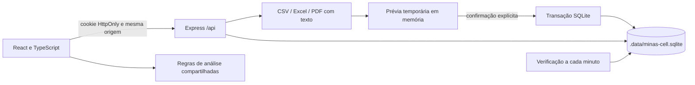

# Arquitetura e contratos

## Implementação que executa hoje

Node.js 24 fornece `node:sqlite`. `server/store.ts` mantém entidades de domínio
como documentos JSON em tabelas SQLite, além de tabelas estruturadas para contas,
sessões e snapshots de importação. Não existe conexão PostgreSQL no fluxo atual.
`shared/types.ts` define o contrato entre API, importador e interface;
`shared/analytics.ts` concentra cálculos de metas e resultados. O frontend usa
React, Recharts e CSS; o Vite gera a aplicação estática em `dist/`.

`npm run dev` inicia Express na porta 3001 e Vite na 5173. O proxy do Vite mantém
as chamadas `/api` na mesma origem do navegador. `npm run build` verifica tipos
e compila o frontend. `npm start` inicia o servidor em modo de produção, que
serve `dist/` e `/api` no mesmo endereço. O endpoint público `/api/health`
identifica o modo `local` e o armazenamento `sqlite`.

## Identidade e autorização local

A primeira conta administrativa é criada na interface. O endpoint de setup
verifica novamente a ausência de contas dentro de uma transação, evitando dois
administradores iniciais por corrida. Depois disso, somente o administrador
cria acessos de vendedor associados a um cadastro existente. Não há senha padrão
nem conta administrativa embutida no código.

Senhas recebem salt aleatório e derivação scrypt; o servidor compara os hashes
em tempo constante. A sessão usa token aleatório, guarda apenas seu SHA-256 no
banco e expira em 12 horas. O cookie `minas_session` é HttpOnly, SameSite Strict
e Secure quando a origem é HTTPS ou `COOKIE_SECURE=true`. O logout remove a
sessão. As mutações verificam a origem e a API limita tentativas de autenticação.

O backend exige autorização em cada rota: importar, alterar metas/configurações,
gerenciar vendedores e consultar auditoria são operações administrativas.
Vendedores recebem suas próprias vendas e resumos; o ranking tem resultados
agregados da equipe, sem expor linhas de vendas de outros vendedores. O frontend
não é a barreira de autorização. O modo local atende uma loja em um único banco,
sem isolamento multiempresa implementado no aplicativo.

## Importação e integridade

O upload é limitado a 10 MB e o endpoint limita a importação a 50.000 linhas.
O parser também verifica formato, dimensões de planilhas, expansão de XLSX e
quantidade de páginas PDF. CSV e Excel fornecem tabelas; a extração PDF usa a
posição do texto e exige conferência humana. Não há OCR.

A prévia contém mapeamento, problemas, vendedores não resolvidos, intervalo,
duplicados, atualizações e somas propostas. Ela pertence ao usuário que a criou,
expira em 30 minutos, fica somente na memória do processo e não conta como
importação concluída. O arquivo bruto não é retido pelo armazenamento local.

Na confirmação, o backend recalcula o plano a partir do estado atual, valida as
opções de atualização/substituição e executa vendas, resumos, lote, snapshot e
auditoria em `BEGIN IMMEDIATE`/`COMMIT`. Qualquer falha provoca rollback. O
identificador externo reconcilia vendas existentes; na ausência dele, utiliza-se
fingerprint do conteúdo, com aviso sobre vendas idênticas. Relatórios acumulados
passam pela mesma conciliação, evitando adicionar de novo tudo o que já existia.

Linhas de itens de uma mesma venda são reconciliadas sem presumir que o total
repetido em cada linha deve ser somado. Dados ambíguos exigem revisão. Status
cancelado/devolvido são preservados, mas excluídos dos indicadores de vendas
válidas. Valores financeiros são inteiros em centavos; não se soma moeda com
aritmética decimal binária. O líquido explícito da origem é autoritativo, mesmo
quando difere de bruto menos desconto; o importador sinaliza essa divergência
para conferência, sem substituir o valor informado.

Resumos guardam faturamento, contagem e intervalo original. Não são repartidos
por dias nem atribuídos a financeiras sem dados de origem. A confirmação bloqueia
sobreposição parcial que eliminaria parte de um resumo; substituições completas
exigem consentimento explícito. O cálculo informa limitações quando um filtro
recorta parte de um período consolidado. Reverter um lote só é permitido na
ordem inversa de confirmação, com comparação do snapshot posterior para evitar
apagar alterações mais recentes.

O SQLite local guarda metas por competência em `settings.goalsByMonth`, com
faturamento da loja e dos vendedores por chave `AAAA-MM`. As análises consultam
o mês selecionado. Meses sem configuração específica usam as metas padrão
presentes em configurações/vendedores; o backend valida competências e vínculos
de vendedor antes de persistir o mapa.

## Calendário, alertas e disponibilidade

O calendário contém dias da semana abertos, feriados e exceções de abertura;
uma data especial aberta prevalece sobre o feriado. As datas comerciais usam
`America/Sao_Paulo`. O horário de lembrete padrão é 08:30, configurável na loja.

O backend verifica a pendência na inicialização e a cada minuto. Em um dia
aberto, depois do horário, sem lote confirmado naquele dia, ele grava um alerta
com identidade única `import-pending:AAAA-MM-DD`. A existência dessa chave evita
duplicar o aviso; confirmar uma importação marca o alerta do dia como lido. O
serviço recupera a verificação do dia atual ao reiniciar, sem simular execução
nos dias em que esteve desligado.

Esse mecanismo persiste o aviso no SQLite mesmo sem uma página aberta, mas
precisa do processo Node em execução. A interface mostra a central de avisos.
Não há assinatura Push API, servidor de web push, entrega externa, e-mail ou
WhatsApp; fechar o navegador não dispara uma notificação externa. O manifesto
permite instalação em navegadores compatíveis, enquanto o service worker evita
cachear respostas financeiras e não oferece funcionamento offline completo.

Uma implantação deve manter um processo da API e um volume persistente para
`DATA_DIR`, com HTTPS no proxy. Não se deve iniciar múltiplas réplicas com caches
de prévias independentes sobre o mesmo SQLite. Backups exigem a API de backup
consistente do SQLite ou todos os escritores parados antes de copiar o diretório
do banco, incluindo os arquivos WAL relacionados. Um `cp` isolado do arquivo
principal durante gravações não produz garantia de consistência.

## Modelo futuro PostgreSQL/Supabase

`supabase/migrations/0001_initial.sql` é uma proposta de migração separada do
runtime atual. Não foi aplicada a um projeto Supabase e não substitui o SQLite.
Uma dependência cliente Supabase, por si só, não constitui um adapter.

| Tabelas | Responsabilidade |
| --- | --- |
| `stores` | Fronteira de isolamento por loja. |
| `profiles` | Liga `auth.users.id` a loja, papel e vendedor. Não armazena senha. |
| `sellers`, `goals` | Cadastro e metas por competência mensal, da loja ou do vendedor. |
| `sales`, `sale_items`, `payments`, `financiers` | Transações, itens e pagamentos normalizados, dinheiro `bigint` em centavos. |
| `imported_files`, `import_batches`, `import_lines` | Arquivo privado, lote, decisões, linhas e snapshots de reversão. |
| `consolidated_summaries` | Totais por vendedor e período, sem inventar detalhamento. |
| `audit_entries`, `settings` | Trilha de operações e calendário/configuração. |
| `alerts`, `notifications` | Pendências deduplicadas e avisos por destinatário. |

As chaves estrangeiras compostas incluem `store_id`, impedindo que um registro
de uma loja referencie vendedor, lote, financeira ou perfil de outra. IDs
externos têm índice único por loja. O fingerprint só é único entre vendas sem
ID externo: duas vendas distintas com IDs válidos podem ter conteúdo idêntico.
Metas têm uma linha por loja/vendedor e primeiro dia do mês; a meta geral usa
`seller_id` nulo. Campos monetários usam `bigint`, com validações de valores
não negativos e de limites de desconto. O schema preserva o líquido informado
sem impor `net_cents = gross_cents - discount_cents`, alinhado ao contrato do
importador; divergências exigem o mesmo aviso de conferência em um futuro adapter.

Todas as tabelas de domínio habilitam RLS. Sem usuário autenticado, não há
acesso. Helpers `SECURITY DEFINER` usam `search_path` vazio e referências
qualificadas para consultar o vínculo protegido do usuário. Administradores
acessam os registros de sua loja; vendedores leem suas vendas, itens,
pagamentos, resumos e metas, mais as configurações e financeiras da loja.
Auditoria é somente leitura para o cliente administrativo. Notificações só
permitem ao destinatário atualizar a coluna `read_at`.

Clientes não têm permissões de escrita direta em `profiles`. A função
`admin_set_profile` exige um administrador já existente, impede alterar o
próprio perfil e rejeita associação a outra loja. Ela usa a identidade
`auth.uid()`, sem confiar em metadados editáveis do usuário. O primeiro vínculo
administrativo de um projeto Supabase deve ser criado por um operador confiável
no SQL Editor/migração de provisionamento, após criar a conta no Auth. Nenhuma
conta ou papel é promovido automaticamente por cadastro público. Uma futura
integração precisa implementar convites e gestão de identidades no servidor;
chaves `service_role` nunca podem ser expostas no navegador.

O bucket `imports` é privado, com limite de 20 MiB e lista de MIME types para
CSV/Excel/PDF. As policies de Storage exigem administrador e primeiro diretório
igual ao ID da loja: `<store_id>/<uuid>/<arquivo>`. O limite planejado do bucket
não muda o limite local atual de 10 MB. MIME type não dispensa validar o conteúdo
do arquivo no backend. URLs públicas não devem ser usadas para relatórios.

## O que falta para ativar Supabase

1. Provisionar um projeto de desenvolvimento e aplicar a migração com uma conta
   autorizada. Criar loja, configurações e o primeiro perfil administrativo
   associado a uma identidade real de `auth.users` por um canal confiável.
2. Implementar o adapter de persistência, a troca de autenticação e as operações
   do backend. O formato SQLite em documentos não é uma importação SQL direta:
   é necessário transformar itens, pagamentos, metas, IDs e associações.
3. Implementar uma RPC transacional de confirmação/reversão com bloqueio por
   loja. Validações de somas de itens/pagamentos, sobreposições e snapshots
   precisam acontecer no servidor; os índices únicos sozinhos não executam esse
   fluxo. Escritas diretas nas tabelas não equivalem a uma confirmação atômica.
4. Executar testes reais com administrador e vendedores de duas lojas:
   leitura e escrita cruzadas negadas, autoelevação de papel negada, caminhos
   Storage isolados, repetição/acúmulo idempotentes, concorrência, rollback e
   backup/restauração. A validação local do aplicativo não prova RLS remota.
5. Implementar e publicar um agendador externo, se necessário. Para a execução
   diária de referência, 08:30 em São Paulo corresponde a 11:30 UTC no regime
   atual; prefira um agendador que aceite `America/Sao_Paulo`, preservando a
   regra civil caso o fuso mude. pg_cron normalmente usa UTC: a expressão
   `30 11 * * *` é apenas uma referência, **não uma configuração executada**.
   A função futura deve verificar calendário, timezone e chave idempotente por
   loja/data antes de criar avisos. Web push exigirá também inscrição do
   navegador, serviço de entrega e gestão segura das respectivas credenciais.

## Desenvolvimento e validação

Use o checkout existente, sem criar outro Git worktree: a tarefa de nuvem já
possui isolamento. `npm ci` instala a partir do lockfile; `npm test` executa as
fixtures temporárias de domínio/importação/API; `npm run build` verifica tipos
e compila; `npm run dev` ou `npm start` executam o sistema. `npm run test:e2e`
inclui o build e verifica fluxos no Chromium, com banco temporário independente.
O navegador vem de `CHROMIUM_PATH`, de uma instalação Chromium local ou de
`npx playwright install chromium`. Os testes não criam
vendas no banco do usuário. As exportações da interface partem dos dados reais
carregados e não preenchem resultados quando a base está vazia.

Fixtures de parser e cenários do navegador não são exportações reais do SH
Sistemas e não comprovam todos os critérios de aceitação de uma implantação.
A homologação de formatos reais deve ser feita com um relatório da operação.

Limitações deliberadas: uma loja e um processo no runtime local,
prévias voláteis, sem comparativos mensais completos ou análises semanais
avançadas, sem OCR, sem adapter Supabase ativo, sem
web push externo e sem cron de produção provisionado. A ativação dos serviços
futuros exige implementação e validação próprias.
